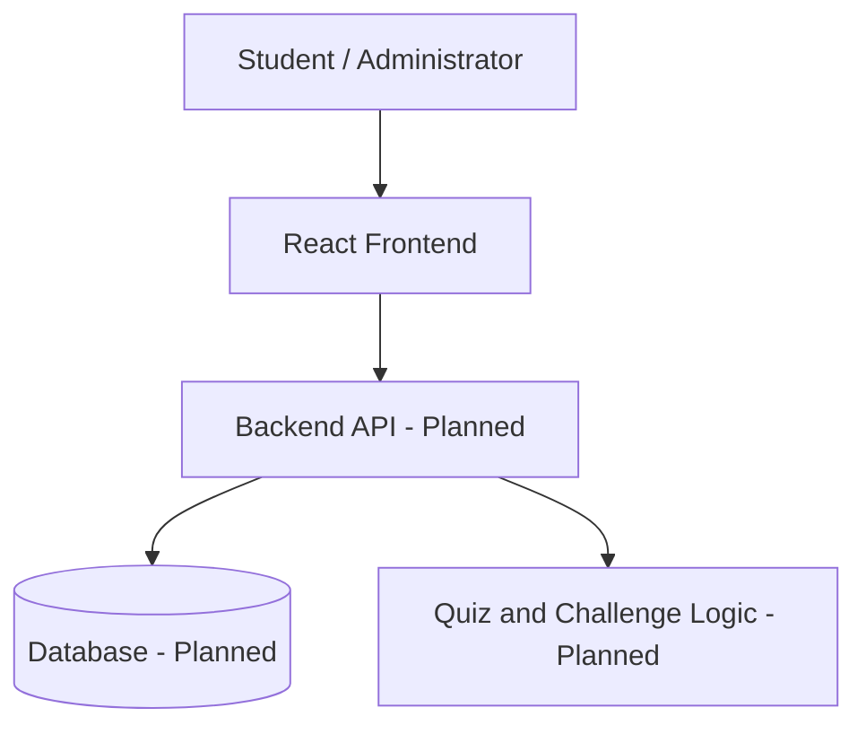

# 🌱 EcoQuest — Gamified Environmental Education Platform

**A Gamified Environmental Education Platform for Schools and Colleges**

🚀 **Live Demo:** [Open EcoQuest Website](https://gamified-environmental-education-pl-delta.vercel.app/)

## 📌 About the Project

EcoQuest is a web-based environmental education project designed to encourage students to learn about environmental awareness, sustainability, and eco-friendly practices through an engaging digital experience.

The project explores gamification concepts to make environmental learning more interactive and interesting through quizzes, challenges, and rewards.

## 🎯 Problem Statement

Students may have limited awareness of environmental issues and sustainable practices. Traditional learning methods may not always provide enough interactive activities to encourage students to participate in environmental education.

EcoQuest aims to address this challenge by creating an engaging digital platform for environmental learning and promoting sustainable habits.

## 🎯 Project Objectives

- Increase environmental awareness among students.
- Encourage interactive learning about sustainability.
- Introduce environmental quizzes and challenges.
- Motivate students through gamification concepts.
- Promote responsible and eco-friendly habits.
- Provide a foundation for tracking learning progress.

## 👥 Target Users

### Students

- Explore environmental learning content.
- Learn about sustainability and eco-friendly practices.
- Participate in quizzes and environmental challenges where implemented.

### Administrators — Planned Enhancement

- Manage student accounts.
- Create and manage quizzes.
- Organize environmental challenges.
- Monitor student participation.

*The availability of these features depends on the current implementation.*

## ✨ Project Modules

1. User Interface
2. Environmental Learning
3. Quiz Module — based on implementation
4. Environmental Challenges — based on implementation
5. Rewards and Gamification — based on implementation
6. Progress Tracking — planned enhancement
7. Administration — planned enhancement

## 🛠️ Technologies Used

### Frontend

- React.js
- JavaScript
- HTML
- CSS

### Development and Deployment Tools

- Visual Studio Code
- Git
- GitHub
- Vercel

*Refer to `package.json` for the project's dependencies and available scripts.*

## 🏗️ System Architecture

The current application is deployed as a web frontend. Backend services and database integration can be introduced to support persistent user accounts, quiz records, rewards, and learning progress.

### Proposed Architecture



*The backend and database components shown above are proposed enhancements, not confirmed existing integrations.*

## 🗂️ Proposed Database Design

The following entities may be considered when backend and database functionality is implemented.

| Entity | Example Attributes |
|---|---|
| Student | Student_ID, Name, Email, Score |
| Quiz | Quiz_ID, Quiz_Name, Points |
| Challenge | Challenge_ID, Challenge_Name, Reward |
| Reward | Reward_ID, Reward_Name, Points |
| Admin | Admin_ID, Name, Email |

*This is a conceptual design. It does not imply that these tables already exist in a connected database.*

## 🚀 Live Deployment

EcoQuest is deployed using Vercel.

**Live Website:** [Visit EcoQuest](https://gamified-environmental-education-pl-delta.vercel.app/)

**Source Code:** [View the GitHub Repository](https://github.com/lakshmiyoga55/Gamified-Environmental-Education-Platform-for-Schools-and-Colleges)

## 💻 Run the Project Locally

### Prerequisites

- Node.js
- npm
- Git

### Installation Steps

**1. Clone the repository**

```bash
git clone https://github.com/lakshmiyoga55/Gamified-Environmental-Education-Platform-for-Schools-and-Colleges.git
```

**2. Navigate to the project directory**

```bash
cd Gamified-Environmental-Education-Platform-for-Schools-and-Colleges
```

**3. Install dependencies**

```bash
npm install
```

**4. Start the development server**

```bash
npm run dev
```

**5. Open the local URL**

Open the URL displayed in your terminal in a web browser.

## 🔮 Future Enhancements

- Student registration and authentication.
- Administrator dashboard.
- Interactive environmental quizzes.
- Environmental challenges and reward points.
- Student progress tracking.
- Backend API integration.
- Database integration.
- Search and filtering for learning activities.
- Responsive design and accessibility improvements.

## 🤝 Contributions

Suggestions and contributions that improve environmental awareness and interactive learning are welcome.

## 📄 License

Refer to the repository's `LICENSE` file for the applicable license terms.
