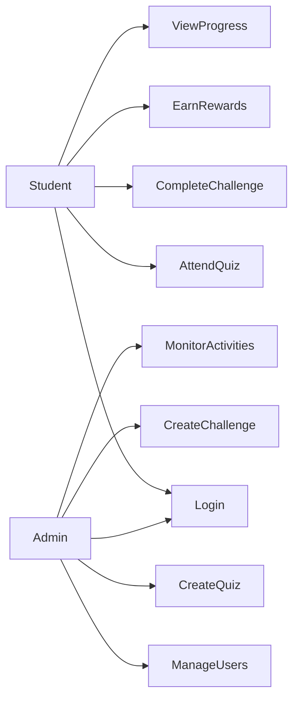
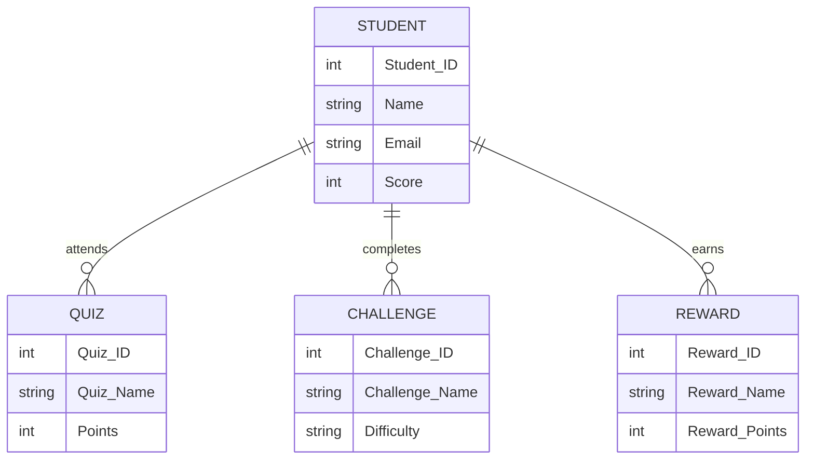

# Gamified Environmental Education Platform for Schools and Colleges

## 🌱 EcoQuest — Live Demo

🚀 **Live Website:** https://gamified-environmental-education-pl-delta.vercel.app

**EcoQuest** is a gamified environmental education platform designed to encourage students to learn about sustainability through interactive quizzes, challenges, and rewards.

## Problem Statement

Students often lack awareness about environmental issues and sustainability practices. This project aims to improve environmental education through quizzes, challenges, rewards, and interactive activities.

# Project Objectives

- Increase environmental awareness among students.
- Encourage learning through quizzes and challenges.
- Reward students for completing activities.
- Track student learning progress.
- Promote sustainable practices.

# User Identification

## Student
- Attend quizzes
- Complete challenges
- Earn rewards
- View progress

## Admin
- Manage users
- Create quizzes
- Create challenges
- Monitor activities

# Module Identification

1. Login Module
2. Quiz Module
3. Challenge Module
4. Reward Module
5. Progress Tracking Module
6. Admin Management Module

# Use Case Diagram

# Database Requirement Analysis

## Student
- Student_ID
- Name
- Email
- Score

## Quiz
- Quiz_ID
- Quiz_Name
- Points

## Challenge
- Challenge_ID
- Challenge_Name
- Reward

## Reward
- Reward_ID
- Reward_Name
- Points

## Admin
- Admin_ID
- Name
- Email

# ER Diagram

# Database Schema

Tables:
1. Student
2. Quiz
3. Challenge
4. Reward
5. Admin

# Login and Dashboard UI

- Student Login Screen
- Admin Login Screen
- Student Dashboard
- Admin Dashboard

  # Navigation and Form Design

Forms:
- Login Form
- Quiz Form
- Challenge Submission Form

Navigation:
- Home
- Dashboard
- Quiz
- Challenges
- Rewards

  # Design Review

- Reviewed project requirements
- Verified UI design
- Verified database design
- Approved system design

  # Frontend Environment Setup

## React Project Setup

Tools Used:
- React.js
- VS Code
- GitHub

# Login Module

## Description
The login module allows students and administrators to access the system securely.

## Features
- Student Login
- Admin Login
- Username Validation
- Password Validation

# Registration Module

## Description
The registration module allows new students to create an account.

## Features
- Student Registration
- Email Validation
- Password Creation
- Profile Setup

# Dashboard UI

## Description
The dashboard displays student activities and progress.

## Features
- View Progress
- Quiz Score Display
- Rewards Display
- Challenge Status

# CRUD Form Development

## Description
CRUD operations are used to manage quizzes, challenges, rewards, and student records.

## Operations

### Create
Add new quiz or challenge.

### Read
View existing records.

### Update
Modify quiz, challenge, or reward details.

### Delete
Remove unwanted records.

# Table & Search Features

## Description

This module displays environmental activities, quizzes, and challenges in a table format. Users can search and filter records easily.

## Features

- Display quiz list
- Display challenge list
- Search by title
- Filter by category
- Sort records

# Frontend Testing

## Description

Frontend testing ensures that all user interface pages work correctly.

## Tested Pages

- Login Page
- Registration Page
- Dashboard
- Quiz Page
- Challenge Page
- Reward Page

# Spring Boot Project Setup

## Description

The backend project is created using Spring Boot.

## Technologies Used

- Java
- Spring Boot
- Maven
- MySQL

# Database Connectivity

## Description

The application is connected with the MySQL database to store and retrieve data.

## Database

- MySQL

## Tables

- Student
- Quiz
- Challenge
- Reward

# Database Connectivity

## Description
The application is connected to the MySQL database for storing and retrieving data.

## Technologies
- MySQL
- Spring Boot
- JDBC

# Entity & Repository Creation

## Description
Entity classes represent database tables, and repositories perform CRUD operations.

## Entities
- Student
- Quiz
- Challenge
- Reward

# REST API Development

## Description
REST APIs are developed for communication between frontend and backend.

## APIs
- Login API
- Register API
- Quiz API
- Challenge API
- Reward API

# Authentication Module

## Description
Authentication verifies user identity before accessing the system.

## Features
- Student Login
- Admin Login
- Secure Authentication

# Business Logic

## Description
Business logic manages quizzes, challenges, rewards, and student progress.

## Functions
- Quiz Management
- Challenge Management
- Reward Management

# API Testing

## Description
REST APIs are tested using Postman.

## Tested APIs
- Login
- Register
- Quiz
- Challenge
- Reward

# Frontend & Backend Integration

## Description
Frontend is connected with backend APIs to exchange data.

## Technologies
- React.js
- Spring Boot
- REST API

# Bug Fixing & Validation

## Description
Application bugs are identified and fixed to improve performance.

## Validation
- Login Validation
- Form Validation
- Data Validation

# Documentation

## Description
Project documentation and presentation are prepared.

## Documents
- Project Report
- PPT
- GitHub Repository

# Final Project Submission

## Description
The project is completed and submitted successfully.

## Deliverables
- Source Code
- Documentation
- Presentation
- GitHub Repository
