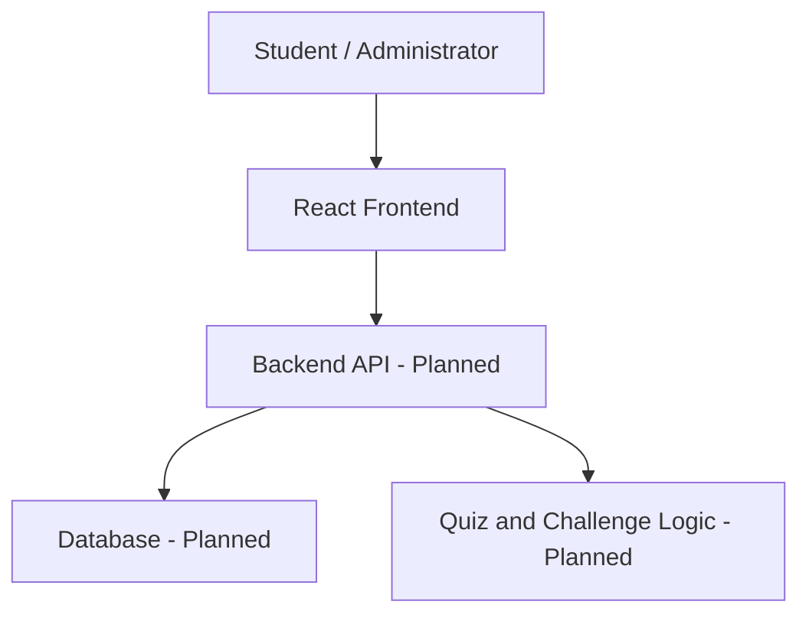

# 🌱 EcoQuest — Gamified Environmental Education Platform

**A Gamified Environmental Education Platform for Schools and Colleges**

🚀 **Live Demo:** [Open EcoQuest Website](https://gamified-environmental-education-pl-delta.vercel.app)

## 📌 About the Project

EcoQuest is a web-based environmental education project designed to encourage students to learn about environmental awareness, sustainability, and eco-friendly practices through an engaging digital experience.

The project aims to make environmental learning more interactive and interesting by using gamification concepts such as quizzes, challenges, and rewards.

## 🎯 Problem Statement

Students may have limited awareness of environmental issues and sustainable practices. Traditional learning methods may not always provide enough interactive activities to encourage students to participate in environmental education.

EcoQuest aims to address this challenge by providing a gamified platform that encourages students to explore environmental topics and develop sustainable habits.

## 🎯 Project Objectives

- Increase environmental awareness among students.
- Encourage interactive learning about sustainability.
- Introduce quizzes and environmental challenges.
- Motivate students through gamification concepts.
- Encourage responsible and eco-friendly habits.
- Provide a foundation for tracking learning progress.

## 👥 Target Users

### Student
- Learn about environmental issues.
- Explore environmental quizzes and challenges.
- Participate in sustainability-related activities.

### Administrator — Planned Enhancement
- Manage student accounts.
- Create and manage quizzes.
- Organize environmental challenges.
- Monitor student participation.

*Administrator functionality depends on the features implemented in the application.*

## ✨ Project Modules

The project is organized around the following modules:

1. User Interface
2. Student Learning
3. Environmental Quiz
4. Environmental Challenges
5. Rewards and Gamification
6. Progress Tracking — Planned Enhancement
7. Administration — Planned Enhancement

*The availability of each module depends on the current implementation.*

## 🛠️ Technologies Used

### Frontend
- React.js
- JavaScript
- HTML
- CSS

### Development Tools
- Visual Studio Code
- Git and GitHub
- Vercel for deployment

*The exact libraries and versions are available in `package.json`.*

## 🏗️ System Design

The current application is deployed as a web frontend. A backend and database can be added to support persistent user accounts, quiz records, rewards, and progress tracking.

### Proposed Architecture



## 🗂️ Proposed Database Design

The following entities may be used when backend and database functionality is implemented.

| Entity | Example Attributes |
|---|---|
| Student | Student_ID, Name, Email, Score |
| Quiz | Quiz_ID, Quiz_Name, Points |
| Challenge | Challenge_ID, Challenge_Name, Reward |
| Reward | Reward_ID, Reward_Name, Points |
| Admin | Admin_ID, Name, Email |

*This is a proposed database design, not a claim that these database tables are already connected.*

## 🚀 Live Deployment

EcoQuest is deployed using Vercel.

**Live Website:** [https://gamified-environmental-education-pl-delta.vercel.app](https://gamified-environmental-education-pl-delta.vercel.app)

The source code is maintained in GitHub.

## 💻 Run the Project Locally

### Prerequisites
- Node.js
- npm
- Git

### Installation

1. Clone the repository:

   ```bash
   git clone https://github.com/lakshmiyoga55/Gamified-Environmental-Education-Platform-for-Schools-and-Colleges.git
   ```

2. Navigate to the project folder:

   ```bash
   cd Gamified-Environmental-Education-Platform-for-Schools-and-Colleges
   ```

3. Install dependencies:

   ```bash
   npm install
   ```

4. Start the development server:

   ```bash
   npm run dev
   ```

5. Open the local URL displayed in your terminal.

## 🔮 Future Enhancements

- Student registration and authentication.
- Administrator dashboard.
- Interactive environmental quizzes.
- Environmental challenges and reward points.
- Student progress tracking.
- Backend API integration.
- Database integration.
- Search and filtering for learning activities.

## 🤝 Contribution

Suggestions and contributions that improve environmental awareness and interactive learning are welcome.

## 📄 License

A license can be added once the project’s distribution terms have been decided.

